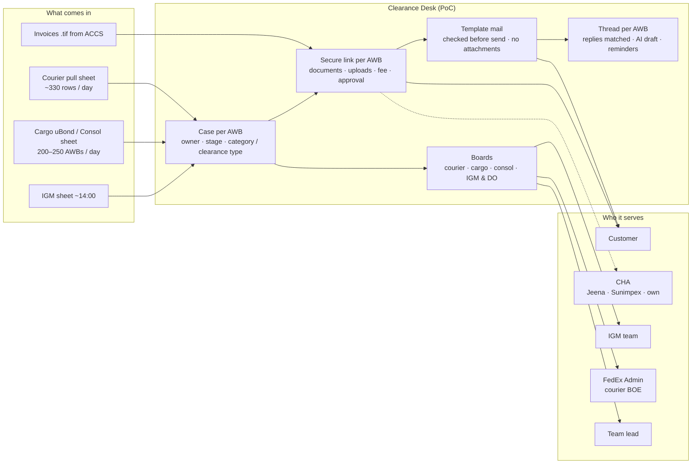

# Clearance Desk — Proof of Concept Handover

**Delhi IGI Import Desks · Courier + Cargo**
Prepared by the Trace Team, Delhi · November 2026

---

## What this pack is

I built a **working proof of concept (PoC)** that shows how the Delhi import desks — **Courier** and **Cargo** — can move from Excel + Outlook + VBA to one system.

FedEx IT will build the production system. This pack hands over:

1. **How the work is done today**, drawn step by step for Cargo and Courier.
2. **The system I have in mind**: the target flow for both desks.
3. **What I built at each step**: working screens, rules and code you can run and reuse.
4. **The technical design**: architecture, data model, APIs and business rules, enough for an engineering team to rebuild it properly.

Everything here runs today on demo data. Where a step is designed but not built, the pack says so.

---

## Documents

| # | Document | What you get | Who should read it |
|---|---|---|---|
| **01** | [Current Process — Cargo & Courier](01_Current_Process_Today.md) | Today's process for both desks, drawn one below the other, with where time and money are lost | Everyone |
| **02** | [The System I Have in Mind](02_Target_System_Vision.md) | The target flow for both desks, the five ideas behind it, and today vs tomorrow | Everyone |
| **03** | [Courier Flow — Explained Simply](03_Courier_Flow_Explained.md) | What a courier exception is, the 11 categories, RBOE, and the flow step by step with what I built | Ops, product, engineering |
| **04** | [Cargo Flow — Explained Simply](04_Cargo_Flow_Explained.md) | uBond vs Consol, NFBRK vs FEBRK, the Consol day clock, IGM matching, DO, with what I built | Ops, product, engineering |
| **05** | [What I Built — Step by Step](05_What_I_Built_Step_by_Step.md) | **The submission.** Each step of each flow: what was built, how it works, and where it is in the code | Manager, engineering lead |
| **06** | [Screen by Screen](06_Screen_by_Screen.md) | Every screen as a layout sketch, in the order a user meets it | Everyone |
| **07** | [Technical Architecture](07_Technical_Architecture.md) | Stack, components, sequence diagrams for the main flows, design rules | Engineering |
| **08** | [Data Model & State Machines](08_Data_Model_and_States.md) | Entity diagram, key tables, lifecycle state diagrams | Engineering |
| **09** | [API & Code Map](09_API_and_Code_Map.md) | Every route and module, so a team can find and reuse anything | Engineering |
| **10** | [Business Rules Reference](10_Business_Rules_Reference.md) | Every rule the system applies: categories, clearance types, readiness, matching, fees, templates | Engineering, QA, ops |
| **11** | [Impact](11_Impact.md) | Time, money, risk and customer experience, before vs after | Manager |
| **12** | [Glossary & Points to Confirm](12_Glossary_and_Points_to_Confirm.md) | Every term explained; process points that ops / compliance should confirm | Everyone |
| **13** | [Multi-Gateway Design](13_Multi_Gateway_Design.md) | One platform for Delhi, Mumbai, Kolkata and more: timings, fees, CHAs, mailboxes and wording set per gateway by the admin | Manager, engineering |

### Reading paths

| If you have… | Read |
|---|---|
| **15 minutes** | 01 → 02 → 05 (the summary table at the top) |
| **To understand the business** | 01 → 02 → 03 → 04 → 06 → 11 → 13 |
| **To build it** | 05 → 07 → 08 → 09 → 10 → 13 |

---

## Status marks

| Mark | Meaning |
|---|---|
| ✅ | **Built** and working in the PoC |
| 🟡 | **Built with a limit**, stated next to it |
| ⬜ | **Designed, not built** |

---

## The PoC in one picture

> **One line:** one sheet upload replaces the morning VBA run and the hand-typed courier mails; one secure link per shipment replaces the chain of attachment mails; and every AWB has one record that Trace, the IGM team, the CHA and Admin all work from.

---

## How to run the PoC

| Step | Command / action |
|---|---|
| Install | `npm install` |
| Configure | Copy `.env.local.example` → `.env.local`; set the Supabase keys; `MAIL_DRIVER=dry_run` (records mails without sending) |
| Database | Apply `supabase/migrations/*` in order; run `scripts/seed-courier-templates.ts` |
| Start | `npm run dev` → `http://localhost:3000` |
| Try courier | Courier → Import → "Download sample" → import → Board → Drafts → send |
| Try cargo | Cargo → Import → choose **Consol** → sample sheet → drop invoices → Send all ready → Consols → upload IGM sheet → Apply → Build notices → Send Touch 2 |
| Tests | `npm test` (67 tests) · `npm run build` |

> Diagrams in this pack use **Mermaid**. They render in GitHub, GitLab, VS Code (Markdown Preview Mermaid extension), Notion and most Markdown viewers.
