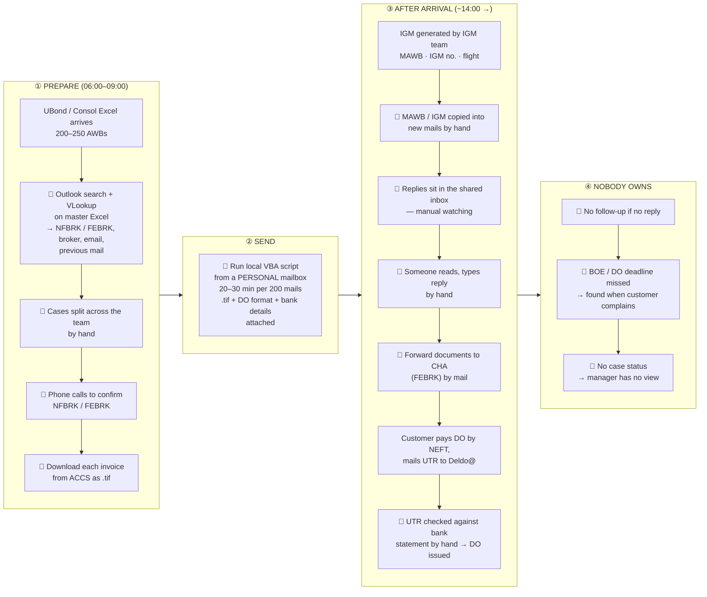
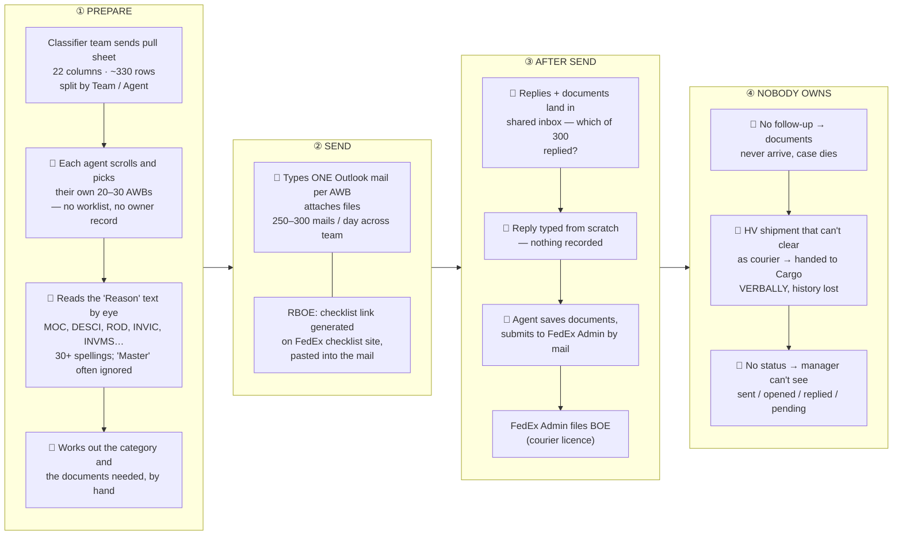
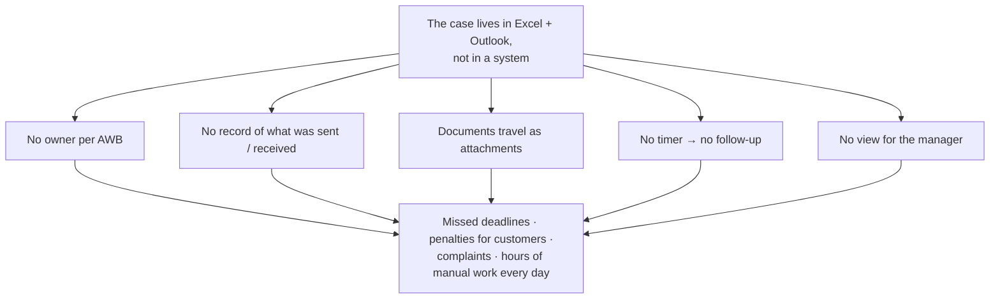

# 01 — Current Process Today: Cargo and Courier

How the two Delhi import desks work **today**, drawn one below the other. 🔴 marks the steps where time, money or information is lost.

---

## The two desks at a glance

| | **Cargo desk** | **Courier desk** |
|---|---|---|
| What arrives | uBond sheet (2–3 days before arrival) and Consol sheet (same day) | Pull sheet from the Classifier team |
| Volume | **200–250 AWBs a day** | **~330 rows a day, 250–300 mailed** |
| Why the customer is contacted | **Every** shipment: pre-alert, documents, MAWB/IGM, DO payment | Only **exceptions**: RBOE approval, CI missing, duty, content, PIMS… (11 types) |
| Who clears customs | A CHA: the customer's own (**NFBRK**) or FedEx-nominated Jeena / Sunimpex (**FEBRK**) | **FedEx Admin team**, under the FedEx courier licence |
| How mails go out | **VBA script** from a personal mailbox, `.tif` invoice attached | **Typed by hand** in Outlook, one by one, documents attached |
| Tools | Excel, a 40K-row master Excel, VLookup, Outlook, VBA | Excel, Outlook |

---

## 1. CARGO — today

### Cargo — where it hurts

| # | Step today | What goes wrong |
|---|---|---|
| 1 | VLookup + Outlook search for broker type and email | Slow; a wrong broker or wrong email on a share of mails. The sheet's `ConsigneeEmailID` column often holds a phone number or `0`; the real email sits in `Standard Remarks` |
| 2 | Hand allocation and calls | Who called whom lives in people's heads |
| 3 | `.tif` invoice download and attach | Done per AWB; customers ask for PDF; heavy mails |
| 4 | VBA from a personal mailbox | Ties up an agent for 20–30 min per run; mail history sits in one person's Sent folder |
| 5 | Consol: the morning mail can't include MAWB/IGM | MAWB/IGM only exist after ~14:00, so they are copied by hand into a second, unthreaded mail |
| 6 | New AWBs in the afternoon IGM sheet (transhipment / part shipments) | Handled ad hoc; these customers get the shortest window of the day |
| 7 | FEBRK: customer ↔ Trace ↔ CHA ↔ IGM team | All by forwarded mail; status found by asking another team |
| 8 | Shared inbox, no follow-up | Replies missed; deadlines found late |

**What it costs the consignee** (FedEx Delhi templates): late BOE ₹5,000/day for 3 days, then ₹10,000/day. DO not collected on arrival day: ₹3,068 → ₹4,248.

---

## 2. COURIER — today

### Courier — where it hurts

| # | Step today | What goes wrong |
|---|---|---|
| 1 | Agent picks rows from the sheet | No owner record; overlap or gaps |
| 2 | Reason read by eye | 30+ spellings for the same thing (`CI Missing` / `Missing CI` / `INVMS`); the authoritative `Master` value is ignored |
| 3 | One mail typed per AWB | 250–300 hand-typed mails a day; inconsistent wording; wrong document list |
| 4 | Attachments | Customer documents travel by mail; no single copy |
| 5 | Shared inbox | Nobody knows which AWB replied |
| 6 | No follow-up | The case silently dies |
| 7 | Hand-off to Admin | Forwarded mail; Admin hunts for the file |
| 8 | HV hand-off to Cargo | Verbal; new case elsewhere; history lost |

---

## 3. The same root cause on both desks

| | Cargo loses… | Courier loses… |
|---|---|---|
| Mostly | Time in **lookup, attach and copy-paste** | The **reply-and-document loop** |
| Same five steps underneath | Import → decide → write → send → collect | Import → decide → write → send → collect |

That shared shape is why the PoC is **one system with two desks**, not two tools. See doc 02.

---

## 4. Numbers used in this pack

| Number | What it is | Source |
|---|---|---|
| 200–250 | Cargo AWBs per day | Team |
| 20–30 min | VBA run for 200 mails | Team |
| 2–3 | uBond runs per day | Team |
| ~330 | Courier rows per pull sheet | Pull sheet |
| 250–300 | Courier mails per day | Team |
| 20–30 | Courier AWBs per agent per day | Team |
| 11 | Courier exception categories | Pull sheet `Master` |
| ₹3,068 / ₹4,248 | DO arrival day / next day | Delhi templates |
| ₹5,000 / ₹10,000 per day | Late BOE penalty | Delhi templates (Notification 34/2021) |
