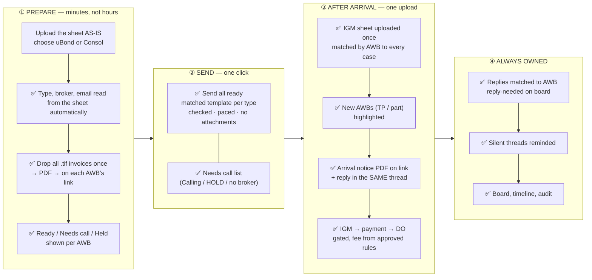
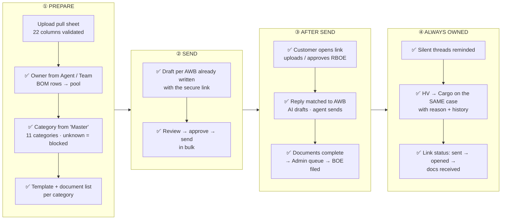
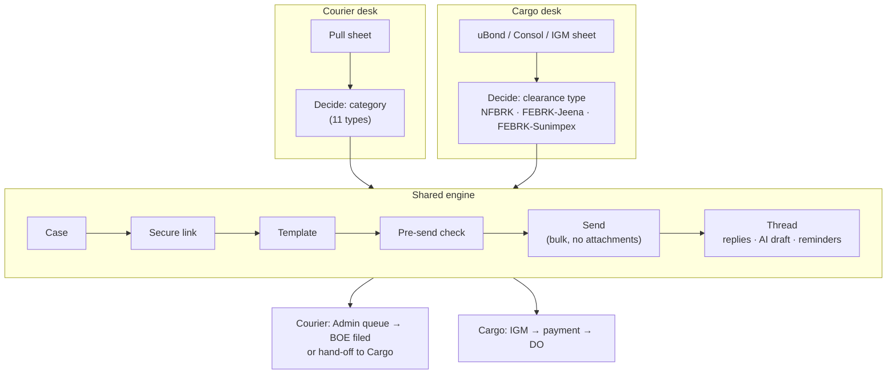
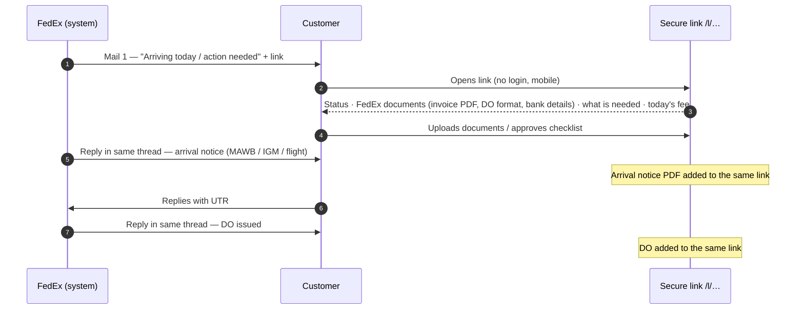

# 02 — The System I Have in Mind

The target: one platform where **every AWB is a case**, **every case has one secure link**, and **every mail goes through one checked pipeline**, for both desks.

***

## 1. Five ideas the whole system is built on

| #     | Idea                                                                                                                                    | What it replaces                                                   |
| ----- | --------------------------------------------------------------------------------------------------------------------------------------- | ------------------------------------------------------------------ |
| **1** | **One case per AWB**: owner, stage, category / clearance type, history                                                                  | Rows in Excel, memory                                              |
| **2** | **One secure link per AWB**: the customer sees status, downloads FedEx documents, uploads theirs, approves checklists, sees today's fee | 5–7 attachments in a single mails, no track of saw the mail or not |
| **3** | **One send pipeline**: template → check → send, in bulk, from a team identity, **with zero attachments**                                | VBA script, hand-typed Outlook mails                               |
| **4** | **One thread per AWB**: replies matched automatically; AI drafts the answer, a person sends it; silent threads get reminded             | Shared inbox                                                       |
| **5** | **One board per role**: everything visible by status, owner and what is blocking it                                                     | Asking around                                                      |

And one rule over all of them: **when unsure, stop and show why. Never guess.** An unknown courier category, a "FEBRK" with no broker, a damaged AWB or a missing email blocks that one row, with a reason, and never the whole batch.

***

## 2. CARGO — with the system

## 3. COURIER — with the system

***

## 4. Both desks, one engine

The two desks differ only in **how the case is decided** (category vs clearance type) and **how it closes** (Admin BOE vs DO). Everything in the middle is shared, so it is built once.

***

## 5. Today vs with the system — side by side

### Cargo

| Step                  | Today                            | With the system                                                                      |
| --------------------- | -------------------------------- | ------------------------------------------------------------------------------------ |
| Sheet                 | Restructured by hand             | Uploaded as-is; operator picks uBond / Consol                                        |
| Broker + email        | VLookup + Outlook search         | Read from `End Result`, `FedEx Broker`, `Standard Remarks`                           |
| Unclear type          | Calls tracked in heads           | **Needs call** list                                                                  |
| Invoices              | `.tif` attached per mail         | Dropped once → PDF → on the link                                                     |
| Sending               | VBA, personal mailbox, 20–30 min | One click, team identity, every mail checked                                         |
| uBond then Consol     | Same AWB mailed twice            | Recognised; same case, same link, no second pre-alert                                |
| MAWB / IGM            | Copied into new mails at 14:00   | One IGM sheet upload updates every AWB; arrival notice PDF; reply in the same thread |
| New AWBs in IGM sheet | Ad hoc                           | Highlighted as "not in consol"                                                       |
| DO fee                | Table in the mail                | Today's fee on the link                                                              |
| Payment → DO          | Excel + mailbox                  | Gated board; DO on the link                                                          |
| Follow-up             | Memory                           | Automatic reminders                                                                  |

### Courier

| Step                | Today                         | With the system                             |
| ------------------- | ----------------------------- | ------------------------------------------- |
| Who works which AWB | Pick from the sheet           | Owner from the sheet; pool for BOM rows     |
| What to ask for     | Reason read by eye            | `Master` → category; unknown blocked        |
| Writing the mail    | Typed per AWB                 | Draft ready per AWB                         |
| Documents           | Attached to mails             | Uploaded on the link; checklist ticks       |
| RBOE                | Link pasted into a typed mail | RBOE template; approve / object on the link |
| Replies             | Shared inbox                  | On the AWB; AI draft; person sends          |
| Follow-up           | Memory                        | Automatic reminders                         |
| To Admin            | Forwarded mail                | Admin queue                                 |
| HV to Cargo         | Verbal                        | Same case moves, with reason and history    |

***

## 6. The customer's view: one link instead of a pile of mails

***

## 7. What stays outside the system

| Stays as it is                               | Why                                                          |
| -------------------------------------------- | ------------------------------------------------------------ |
| **ACCS**: shipments and invoices             | System of record. The PoC reads its exports (sheet + `.tif`) |
| **ICEGATE**: IGM and BOE filing              | Filed by the IGM team, the CHA, or FedEx Admin               |
| **The CHA's filing work**                    | FedEx does not hold a cargo clearance licence                |
| **Payments**: NEFT                           | The system records the UTR; money does not move through it   |
| **Decisions**: calls, approvals, final sends | A person always decides. AI only drafts                      |

***

## 8. Where the system can go next

These are designed, not built. Each is described in docs 03–05.

| Next                                                                    | Effect                                                |
| ----------------------------------------------------------------------- | ----------------------------------------------------- |
| One-click case for new IGM-sheet AWBs (TP / part shipments)             | No new AWB waits for a person to notice it            |
| CHA view of the case (Jeena / Sunimpex / own CHA)                       | Documents stop being forwarded; CHA marks "BOE filed" |
| FEBRK duty checklist approved on the link                               | Before-18:00 approvals tracked, not chased            |
| Invoices pulled from ACCS automatically                                 | The morning `.tif` step disappears                    |
| UTR matched to the bank statement                                       | Payment verified without a person checking            |
| "IGM not generated — ICEGATE issue" mail and day-1 / day-2 DO reminders | Every template moment covered                         |
| Manager SLA view                                                        | Stuck cases surfaced by age                           |

