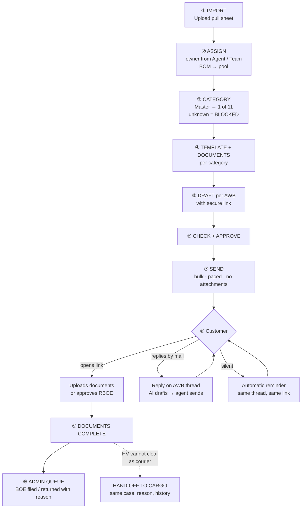
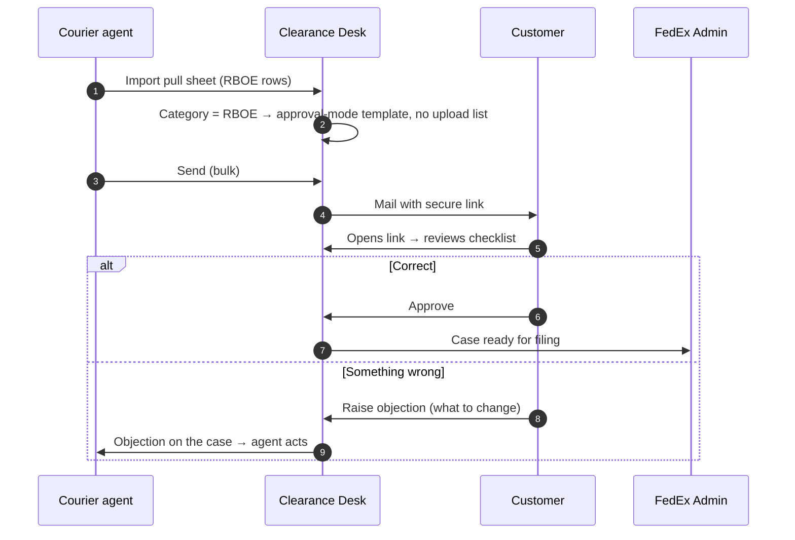
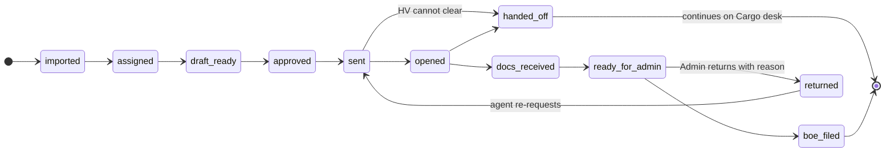

# 03 — Courier Flow, Explained Simply

## 1. What the courier desk does, in plain words

A courier shipment arrives at Delhi IGI. Customs or FedEx's own checks find a problem: the invoice is missing, the description is too vague, duty needs confirmation, a certificate is needed. The **Classifier team** puts every such shipment on a **pull sheet**.

The **Trace courier desk** must then:
1. Tell each customer **exactly what is needed** for their shipment,
2. **Collect** it,
3. Hand the complete file to **FedEx Admin**, who files the Bill of Entry under FedEx's courier licence.

So courier is an **exception desk**: not every shipment, only the ones with a problem. Each problem type needs a different mail and a different set of documents.

---

## 2. The pull sheet

~330 rows a day, 22 columns. The ones that matter:

| Column | Example | Used for |
|---|---|---|
| `AWB` | `8769xxxxxxxx` | The case key |
| `Company` | `ABC OPTICS PVT LTD` | Mail and board |
| `Reason` | `DESCI, CONTENT CLARIFICATION REQD` | Free text from the classifier. The first token is the shorthand |
| `Master` | `Content` | **The authoritative category** |
| `Agent`, `Agent ID`, `Team` | `Agent A`, `1234567`, `SD` | Owner of the case |
| `CEP` | name or `#N/A` | Clearance executive |
| `EDI` | `PPW CALLING` | Status hint |
| `Class` | `MV` / `HV` / `LV` | Value class; HV may need to go to Cargo |
| `Location` | `DEL` / `BOM` | BOM rows go to a pool |
| `IEC_CODE`, `GSTIN` | | Reference |
| `Email` (optional) | | Recipient |

---

## 3. The 11 exception categories

| Category | Reason shorthand on the sheet | What the customer must do | Documents asked for (template) |
|---|---|---|---|
| **RBOE** | `RBOE` | **Approve** the FedEx-prepared checklist (no upload) | — approval only |
| **CI Missing** | `INVMS`, `CI Missing`, `Missing CI` | Send a clear commercial invoice | Corrected commercial invoice, packing list |
| **Invoice Objection** | `INVIC` | Correct the invoice (address, name, total) | Corrected invoice, packing list |
| **Content** | `DESCI` | Describe the item properly | Invoice with full description, datasheet |
| **Duty** | `ROD` | Confirm assessed duty | Duty acceptance on letterhead, invoice with HSN |
| **PIMS** | `PIMS` | Provide PIMS registration | PIMS certificate, invoice |
| **CBE14 / SVB** | `SVB`, `CBE14` | Provide SVB / CBE certificate | SVB / CBE certificate, invoice |
| **Port Return** | `PFEXP` | Port return / re-export papers | Port return documents, invoice |
| **Value Clarification** | `VALDS` | Prove the declared value | Invoice with value and currency, payment proof |
| **R&R** | `EXP_DOCS` | Return / repair papers | Export documents, invoice, undertaking |
| **MOC / DGCA** | `MOC` | Provide MOC / DGCA NOC | MOC / DGCA NOC, invoice |

In a real sample, RBOE was the biggest block (143 rows), then CI Missing (92), PIMS (32), Invoice Objection (18), Content (17), Duty (13).

---

## 4. The courier flow, step by step, with what I built

| # | Step | What the PoC does | Status |
|---|---|---|---|
| ① | **Import** | Reads the pull sheet by header name (synonyms allowed; `AWB` and `Reason` required). Names the pull `COURIER-YYYY-MM-DD-AM/PM`. Flags problems in the preview: missing email, 11-digit AWB, checklist already sent, duplicate AWB, CEP unresolved, BOM pool. Duplicate AWB attaches to the existing case. | ✅ |
| ② | **Assign** | Owner taken from the sheet, or "assign to me" on import; BOM rows go to a pool; agents claim from the board. | ✅ |
| ③ | **Category** | `Master` first, then the `Reason` shorthand. Spelling variants merged (`CI Missing` = `Missing CI` = `INVMS`). Two strong matches = conflict, flagged. No match = **blocked**, never a default template. | ✅ |
| ④ | **Template + documents** | Category → active template + required-document list (table §3). No template = blocked. RBOE = approval mode. | ✅ (document lists for some categories to be confirmed by ops 🟡) |
| ⑤ | **Draft** | One draft per AWB with consignee, AWB, reason and the secure link already in it. Bulk "compose drafts" for a whole pull. | ✅ |
| ⑥ | **Check + approve** | Pre-send check: valid email, category set, active template, link exists, no attachments. Fails = blocked with reasons. Agent approves (single or bulk). | ✅ |
| ⑦ | **Send** | Bulk send of approved / ready AWBs, paced, per-row result, retry; from the configured mailbox. | ✅ |
| ⑧ | **Customer link** | Upload mode: checklist + upload boxes. RBOE mode: checklist + **Approve / Raise objection**. Opens and uploads recorded. | ✅ |
| ⑧ | **Replies** | Inbox polled; reply matched to the AWB; one conversation per AWB. AI classifies the reply (simple acknowledgement / needs answer / escalate / out-of-office) and drafts an answer. **Auto-send is switched off**: a person sends. | ✅ |
| ⑧ | **Reminders** | Silent threads get a template reminder on the same thread and link; one per stale period. | ✅ (production schedule to be set 🟡) |
| ⑨ | **Documents complete** | Marked automatically by uploads or by the agent ("docs received"). | ✅ |
| ⑩ | **Admin queue** | Agent submits → Admin queue → BOE filed or returned with a reason. | ✅ |
| — | **HV to Cargo** | One action with a reason: the same case moves to the Cargo desk, keeping its link, documents and history. | ✅ |

---

## 5. RBOE: the biggest category, explained

RBOE shipments do not need documents. The customer only has to **approve a checklist** that FedEx has already prepared.

---

## 6. How a reply is handled

| Reply looks like | Route | What happens |
|---|---|---|
| "received / thanks / confirmed", or RBOE approved | Simple acknowledgement | AI drafts a short reply. *(Auto-send designed, switched off in the PoC)* |
| Question about invoice / documents / clarification | Needs an answer | AI drafts from this AWB's facts; agent edits and sends |
| Escalation, legal, complaint, VIP, urgent | Human only | No AI draft; flagged to the agent |
| Out-of-office, bounce | Ignore | Kept on the thread, no action |

---

## 7. Link status: what the agent and lead see

---

## 8. Courier case lifecycle

