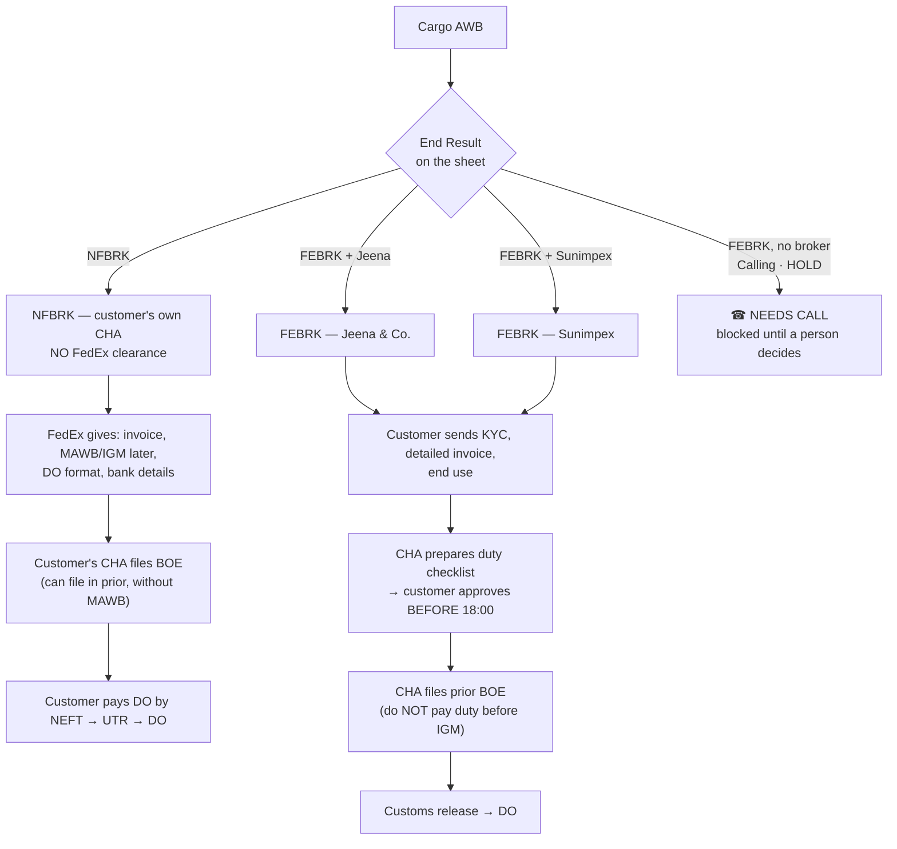
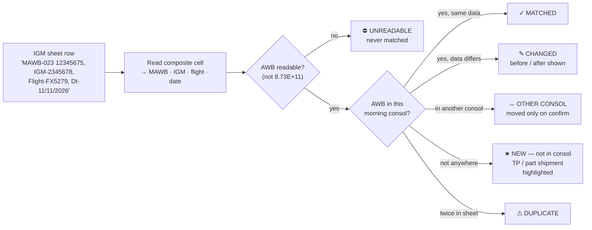
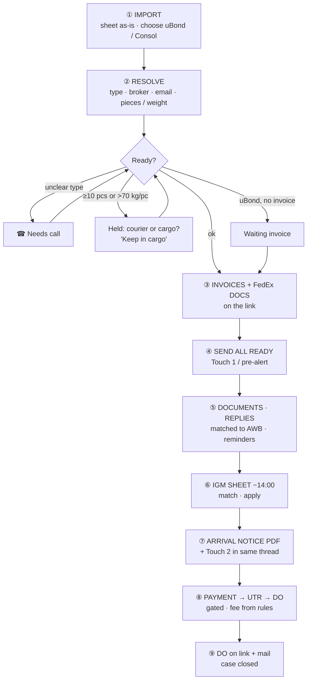
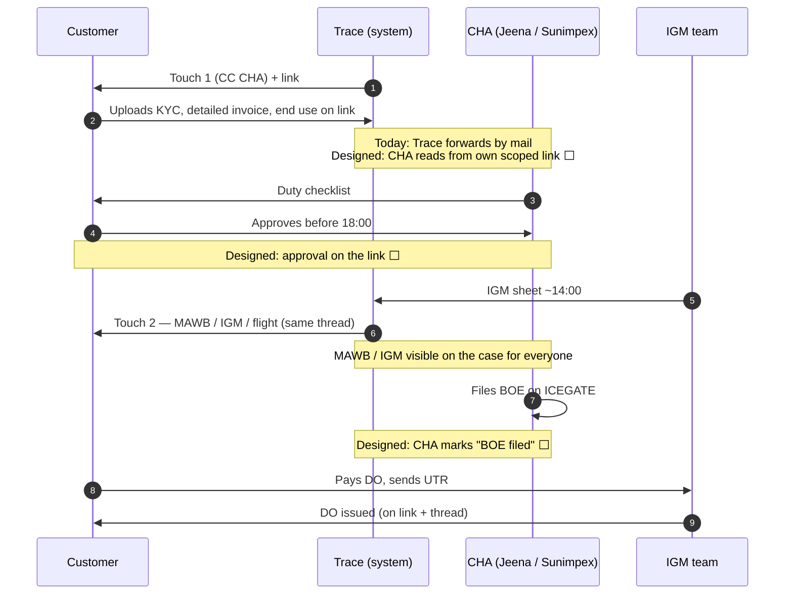

# 04 — Cargo Flow, Explained Simply

## 1. What the cargo desk does, in plain words

Every cargo import shipment into Delhi needs its **Bill of Entry (BOE)** filed by a customs broker (**CHA**), and its **Delivery Order (DO)** collected from FedEx against payment. FedEx does not hold a cargo clearance licence, so the CHA always files.

The **Trace cargo desk** makes that happen on time for 200–250 AWBs a day:
1. Tell the customer the shipment is coming, with the invoice, so their CHA can file **early**.
2. After the flight's **IGM** is generated (~14:00), send the **MAWB / IGM / flight** details.
3. Coordinate documents (and, for FEBRK, the CHA).
4. Get the DO paid and collected.

Two questions decide everything for a cargo AWB:

| Question | Answer A | Answer B |
|---|---|---|
| **Who clears it?** | **NFBRK**: the customer's own CHA. **No FedEx clearance.** | **FEBRK**: **FedEx clearance** through a nominated CHA, **Jeena & Co.** or **Sunimpex** |
| **When is it mailed?** | **uBond**: 2–3 days before arrival, one mail | **Consol**: same day, two mails (morning + after IGM) |

---

## 2. NFBRK vs FEBRK

| | **NFBRK** | **FEBRK** |
|---|---|---|
| FedEx clearance | **No** | **Yes**, via Jeena or Sunimpex |
| Who files BOE | Customer's CHA | Nominated CHA |
| Trace's work | Inform, give documents, push early filing, DO | All of that **plus continuous coordination**: customer ↔ CHA (external) ↔ IGM team (internal), all by mail today |
| CC on mail | FedEx cargo desk | CHA's ops list + FedEx cargo desk |
| Key deadline | File BOE early; collect DO on arrival day | Checklist approval before 18:00; BOE filed after IGM |
| Charges in the mail | DO: ₹3,068 arrival day / ₹4,248 next day | Clearance ₹3,000 + GST, duty and warehouse at actuals, duty advancement fee |
| Template in the PoC | `nfbrk` | `febrk-jeena`, `febrk-sunimpex` |

---

## 3. uBond vs Consol

| | **uBond** | **Consol** |
|---|---|---|
| When | 2–3 runs a day; arrival in 2–3 days | Sheet 06:00–08:00; arrives the same morning |
| Mails per AWB | 1: pre-alert | 2: **Touch 1** "arriving today" (no MAWB yet) and **Touch 2** arrival notice after IGM |
| Hard rule | **Invoice must be on the link before the mail goes**, so the CHA can file in advance | Touch 1 must go before IGM; Touch 2 within 30 min of IGM |
| Same AWB seen in both | — | Recognised: same case, same link, **no second pre-alert**; only Touch 2 goes |

---

## 4. The Consol day

```mermaid
gantt
    title Consol day at Delhi (one flight)
    dateFormat HH:mm
    axisFormat %H:%M
    section Trace
    Consol sheet arrives + upload       :a1, 06:00, 2h
    Drop invoices (.tif)                :a2, 06:30, 90m
    Touch 1 — "arriving today"          :crit, a3, 07:30, 90m
    Customer documents window           :a4, 08:30, 330m
    Touch 2 — arrival notice            :crit, a6, 14:00, 30m
    Document cut-off                    :milestone, a7, 16:30, 0m
    section Flight
    Lands Delhi                         :b1, 08:00, 60m
    section IGM team
    IGM generated + IGM sheet           :crit, c1, 14:00, 15m
    Payment → DO                        :c2, 14:30, 180m
```

| Time | What happens | In the PoC |
|---|---|---|
| 06:00–08:00 | Consol sheet arrives; uploaded **as-is**, stream = Consol | ✅ |
| | ACCS invoices dropped once → PDF → on each link | ✅ |
| 07:30–09:00 | **Touch 1**: "arriving today". NFBRK: file BOE in prior. FEBRK: send KYC / checklist documents. MAWB/IGM shown as *"will be shared once generated"* | ✅ |
| 08:30–14:00 | Customer uploads on the link; CHA prepares | ✅ |
| ~14:00 | **IGM sheet** uploaded once → matched to every AWB → MAWB / IGM / flight / pieces / weight written | ✅ |
| | **New AWBs** in the IGM sheet that were not in the morning (transhipment / part shipments) **highlighted** | ✅ highlighted · ⬜ one-click case creation |
| 14:00–14:30 | **Arrival notice PDF** per AWB on the link + **Touch 2** as a reply in the Touch 1 thread | ✅ |
| 16:30 | Document cut-off (14:30 on a customs holiday). After the arrival day DO ₹3,068 → ₹4,248 | Fee tier shown on link ✅ |
| Afternoon → | IGM team: payment → UTR → DO; DO on the link | ✅ (UTR typed 🟡) |

---

## 5. The afternoon IGM sheet: why matching matters

The IGM sheet is **not the same list** as the morning sheet.

| Rule | Why |
|---|---|
| **Match by AWB only**, never company name | Names differ between sheets (`Pvt Ltd`, punctuation); name matching puts a MAWB on the wrong shipment |
| **Reject damaged AWBs** (scientific notation, decimals, < 10 digits) | Excel has already lost digits |
| **New AWBs are shown, never silently created** | These customers got no morning mail and have the shortest window, so a person must see them |
| **Part arrival** (`Pcs code = P`) | Shown on the arrival notice; ⬜ board highlight planned |

---

## 6. The cargo flow, step by step, with what I built

| # | Step | What the PoC does | Status |
|---|---|---|---|
| ① | **Import** | Operator picks uBond or Consol. Reads the real 25-column sheet, including the stray time in the first header. Editable preview; reasons per blocked row; sample sheet download. | ✅ |
| ② | **Resolve** | Type from `End Result` + `FedEx Broker` → `nfbrk` / `febrk-jeena` / `febrk-sunimpex`. Bare FEBRK, `Calling`, `HOLD` → Needs call. Email: the first column holding a **valid** address (`Standard Remarks` usually; `ConsigneeEmailID` often has a phone or `0`). Pieces and weight read. | ✅ |
| ② | **Reuse** | AWB imported in the last 24 h (uBond → Consol) → same case, same link; Touch 1 waived. | ✅ |
| ② | **Big-shipment check** | ≥ 10 pieces or > 70 kg per piece → held until a person chooses "Keep in cargo". | ✅ |
| ③ | **Documents** | Bulk drop `.tif` / `.pdf` / `.zip` → TIFF converted to PDF **in the browser** → matched to AWB by filename. Default FedEx documents (DO format, bank details, circular, tariff) placed on every link by template. | ✅ |
| ④ | **Send** | Readiness per AWB (template, link, documents, email, broker, invoice for uBond). "Send all ready" composes each mail from its template, checks it, sends paced, lists blocked rows with reasons. Resend available. | ✅ |
| ⑤ | **Replies** | Matched to the AWB; reply-needed / waiting / stale on the board; agent replies on the thread. Silent threads reminded. | ✅ (cargo AI draft 🟡) |
| ⑥ | **IGM sheet** | Parse, classify (§5), before/after view, apply to all matched cases. | ✅ |
| ⑦ | **Arrival notice** | FedEx-branded PDF per AWB (MAWB, IGM, flight, pieces, weight, DO charges from fee rules) on the link; Touch 2 as a threaded reply. | ✅ |
| ⑧ | **Payment & DO** | IGM filed → payment requested (fee from approved rules for today's day offset) → UTR → verified → DO issued; each button only after the previous step. | ✅ (UTR typed 🟡) |
| ⑨ | **DO** | DO on the link + short mail on the thread. | ✅ |

---

## 7. FEBRK coordination: today vs with the system

---

## 8. Mail moments: which mail goes when

| Moment | NFBRK | FEBRK | In the PoC |
|---|---|---|---|
| uBond pre-alert / Consol Touch 1 | Own broker; file BOE in prior; DO process | Jeena/Sunimpex will clear; 3 steps; send documents | ✅ |
| After IGM (Touch 2) | Details for your CHA + DO | MAWB / IGM / flight; CHA notified | ✅ arrival notice + PDF |
| IGM not generated (ICEGATE issue) | Variant mail | Variant mail | ⬜ |
| Day-1 DO reminder | Collect today, avoid ₹1,180 extra | — | 🟡 generic reminder |
| Day-2 DO notice | DO now ₹4,248 | — | ⬜ |
| DO issued | DO on link + mail | DO on link + mail | ✅ |
