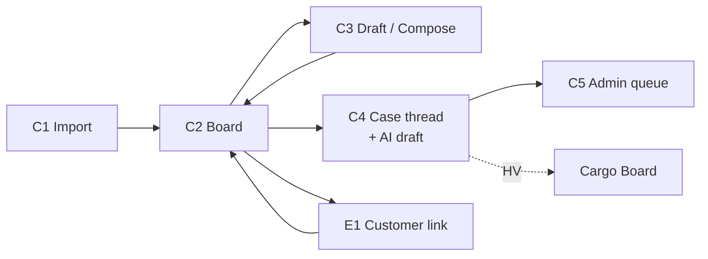
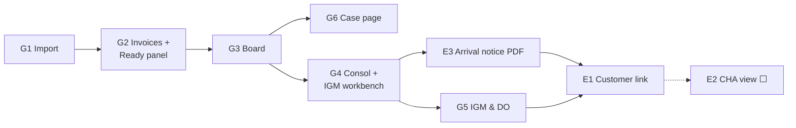

# 06 — Screen by Screen

Each screen with a simple layout sketch, who uses it, and what it replaces. The sketches show the layout and use sample data. Real screenshots from the demo can be added under each one.

Status marks: ✅ built · 🟡 built with a limit · ⬜ designed, not built

---

## How the screens connect

### Courier journey through the screens



### Cargo journey through the screens



---

## 0. The app frame

```
┌──────────────────┬────────────────────────────────────────────────────────────┐
│ CLEARANCE DESK   │                                                            │
│                  │                     (selected screen)                      │
│ Dashboard        │                                                            │
│ ── COURIER ──    │                                                            │
│  Import          │                                                            │
│  Board           │                                                            │
│  Drafts          │                                                            │
│  Links           │                                                            │
│  Admin queue     │                                                            │
│ ── CARGO ──      │                                                            │
│  Import          │                                                            │
│  Board           │                                                            │
│  Send Queue      │                                                            │
│  Drafts          │                                                            │
│  Consols         │                                                            │
│  IGM & DO        │                                                            │
│ ── TEAM ──       │                                                            │
│  Analytics       │                                                            │
│  Settings        │                                                            │
└──────────────────┴────────────────────────────────────────────────────────────┘
```

One login, two desks. A user sees the desk(s) their role allows.

---

# COURIER SCREENS

## C1. Courier Import ✅
**Who:** courier agent · **Replaces:** reading the pull sheet by eye

```
┌ Courier Import ───────────────────────────────────────────────────────────────┐
│  [ Drop pull sheet .xlsx ]        22/22 columns found ✓                       │
│                                                                               │
│  AWB           Company        Master          → Category       Owner   Status │
│  3835870xxxxx  ABC Trading    Port Return       Port Return    Agent A  Ready  │
│  7712xxxxxxxx  K… Pvt Ltd     Missing CI        CI Missing     Agent B  Ready  │
│  6620xxxxxxxx  S… Exports     RBOE              RBOE           Agent A  Ready  │
│  5519xxxxxxxx  M… Ltd         ???               —              —        ⛔ Unknown category │
│  4410xxxxxxxx  P… Corp        Duty              Duty           —        ⛔ No email         │
│                                                                               │
│  412 ready · 2 blocked (reason shown) · 6 to BOM pool        [ Import ]       │
└───────────────────────────────────────────────────────────────────────────────┘
```

## C2. Courier Board ✅
**Who:** courier agent, lead · **Replaces:** shared inbox + memory

```
┌ Courier Board ───────────── [ Mine | Team | Pool ]  Category ▾  Status ▾ ──────┐
│  ▸ Ready to send (38)                                    [ Send selected ]    │
│  ▸ Sent — link not opened (61)                                                │
│  ▸ Link opened — awaiting documents (44)                                      │
│  ▾ Reply needed (9)                                                           │
│     AWB 3835870xxxxx  Port Return  "hi i want more details"   12m ago  [Open] │
│     AWB 7712xxxxxxxx  CI Missing   2 files uploaded           40m ago  [Open] │
│  ▸ Documents received → Admin (17)                                            │
│  ▸ BOE filed (102)                                                            │
└───────────────────────────────────────────────────────────────────────────────┘
```

## C3. Draft / Compose ✅
**Who:** courier agent · **Replaces:** typing each Outlook mail

```
┌ Draft — AWB 7712xxxxxxxx · CI Missing ────────────────────────────────────────┐
│  To: consignee@company.com           Template: CI Missing (v3)                │
│  Subject: FedEx Shipment 7712xxxxxxxx — Commercial Invoice required           │
│  ┌──────────────────────────────────────────────────────────────────────────┐ │
│  │ Dear Customer, your shipment … requires the commercial invoice …         │ │
│  │ Upload here: https://…/l/••••••••    (secure link — no attachments)      │ │
│  └──────────────────────────────────────────────────────────────────────────┘ │
│  Pre-send check:  ✓ template  ✓ recipient  ✓ link  ✓ no attachments           │
│                                               [ Save ]  [ Approve & send ]    │
└───────────────────────────────────────────────────────────────────────────────┘
```

## C4. Case thread with AI draft ✅
**Who:** courier agent · **Replaces:** reading and answering from the shared inbox

```
┌ AWB 3835870xxxxx · Port Return · Owner: Agent A ──────────────────────────────┐
│  ▸ 09:19  OUT  Request for Port Return documents                             │
│  ▸ 09:22  IN   "hi i want more details"                                       │
│  ┌ AI draft (not sent) ─────────────────────────────────────────────────────┐ │
│  │ Dear Customer, a port return needs … please upload on your link …        │ │
│  └──────────────────────────────────────────────────── [ Edit ] [ Send ] ───┘ │
│  Documents: ☑ Letter  ☐ Invoice copy  ☐ KYC          Link: opened 2×          │
│  Timeline · Audit                                                             │
└───────────────────────────────────────────────────────────────────────────────┘
```

## C5. Links & Admin queue ✅
**Who:** lead, FedEx Admin · **Replaces:** forwarded mails "file is ready"

```
┌ Admin queue ──────────────────────────────────────────────────────────────────┐
│  AWB           Category     Documents    Since     Action                     │
│  7712xxxxxxxx  CI Missing   3/3 ✓        10:42     [ BOE filed ] [ Return… ]  │
│  6620xxxxxxxx  RBOE         Approved ✓   11:05     [ BOE filed ] [ Return… ]  │
└───────────────────────────────────────────────────────────────────────────────┘
```

---

# CARGO SCREENS

## G1. Cargo Import ✅
**Who:** cargo agent · **Replaces:** VLookup, Outlook search, manual sheet restructuring

```
┌ Cargo Import ─────────────────────────────────────────────────────────────────┐
│  Stream:  ( ) uBond — 2–3 days before arrival    (•) Consol — same day        │
│  [ Drop cargo sheet .xlsx ]     [ Download sample ]   [ Preview sample ]      │
│                                                                               │
│  AWB           Consignee     End Result  Broker    Email (from Remarks)  Status│
│  8735xxxxxxxx  A… Pvt Ltd    NFBRK       —         ops@a…com           Ready  │
│  8736xxxxxxxx  B… Ltd        FEBRK       Jeena     imp@b…com           Ready  │
│  8737xxxxxxxx  C… Corp       FEBRK       —         —                   ☎ Needs call (no broker) │
│  8738xxxxxxxx  D… Inds       Calling     —         d@…com              ☎ Needs call │
│  8739xxxxxxxx  E… Ltd        NFBRK       —         e@…com              ↺ Sent on uBond │
│  8.74E+11      F… Co         NFBRK       —         f@…com              ⛔ AWB damaged by Excel │
│                                                          (cells editable)     │
│  212 ready · 9 needs call · 1 blocked · 14 already sent      [ Import ]       │
└───────────────────────────────────────────────────────────────────────────────┘
```

## G2. Invoice drop + Ready panel (right after import) ✅
**Who:** cargo agent · **Replaces:** attaching `.tif` to each mail

```
┌ Invoices ─────────────────────────────────────────────────────────────────────┐
│  [ Drop .tif / .pdf / .zip ]   Converting in browser…  ███████████░░ 187/212  │
│  ✓ 8735xxxxxxxx.tif → PDF → attached       ✓ 8736xxxxxxxx.tif → PDF → attached │
│  ⚠ 9999xxxxxxxx.tif — no AWB with this number in this import                 │
├ Ready panel ──────────────────────────────────────────────────────────────────┤
│  Ready to send  198   │ Waived (uBond sent) 14 │ Needs call 9 │ Held ≥10pcs 3 │
│  Missing invoice 14 (uBond only)                                              │
│                                   [ Send all ready — Touch 1 (198) ]          │
└───────────────────────────────────────────────────────────────────────────────┘
```

## G3. Cargo Board ✅
**Who:** cargo agent, lead · **Replaces:** Excel tracking + shared inbox

```
┌ Cargo Board ──────────── Stream ▾  Type ▾  Stage ▾  [ Mine | Team ] ──────────┐
│  Readiness:  Ready 12 · Needs call 9 · Held 3 · Blocked 1 · Sent 198          │
│                                                                               │
│  AWB           Type          Stage        Modules              Thread   Action│
│  8735xxxxxxxx  NFBRK         Pre-alert    ■■■■■■ T L P E B I   Waiting  Resend│
│  8736xxxxxxxx  FEBRK-Jeena   IGM filed    ■■■■■■               Reply ●  Open  │
│  8737xxxxxxxx  FEBRK (?)     —            ■■■■□■  broker ✗     —        Set type│
│  8740xxxxxxxx  NFBRK         Pre-alert    ■■■■■□  invoice ✗    —        Upload │
│                                                                               │
│  Modules: T template · L link · P FedEx doc pack · E email · B broker · I invoice │
└───────────────────────────────────────────────────────────────────────────────┘
```

## G4. Consols list + IGM workbench ✅
**Who:** IGM agent, cargo agent · **Replaces:** copying MAWB/IGM into each mail at 14:00

```
┌ Consol 11-Nov · 212 AWBs ── Touch 1 sent 07:42 ✓ · IGM ⏳ · Touch 2 — ────────┐
│  [ Upload IGM sheet ]                                                          │
│                                                                                │
│  AWB           Company      MAWB            IGM      Flight   Pcs  Wt   State  │
│  8735xxxxxxxx  A… Pvt Ltd   023-1234 5675   2345678  FX5279   2    14   ✓ Matched│
│  8736xxxxxxxx  B… Ltd       023-1234 5675   2345678  FX5279   4    31   ✎ Changed (pcs 5→4) │
│  8790xxxxxxxx  Q… Trading   023-1234 5675   2345678  FX5279   1    6    ★ NEW — not in consol (TP / part) │
│  8791xxxxxxxx  R… Ltd       023-1234 5675   2345678  FX5279   3/5  20   ◐ Part arrival (P) ⬜ │
│  8.73E+11      —            …                                     ⛔ Unreadable│
│                                                                                │
│  [ Apply 209 ]  →  [ Build arrival notices ]  →  [ Send Touch 2 (209) ]        │
└────────────────────────────────────────────────────────────────────────────────┘
```

## G5. IGM & DO board ✅ (UTR typed 🟡)
**Who:** IGM team · **Replaces:** Excel + Deldo@ mailbox tracking

```
┌ IGM & DO ─── [ Needs review | Waiting payment | Ready for DO | Done ] ─────────┐
│  AWB           Type    Stage              Fee today     UTR            Action  │
│  8735xxxxxxxx  NFBRK   IGM filed          ₹3,068        —              [Request payment] │
│  8736xxxxxxxx  FEBRK   Payment requested  ₹3,068        —              waiting │
│  8741xxxxxxxx  NFBRK   Payment requested  ₹4,248 (D+1)  UTR12345…      [Verify]│
│  8742xxxxxxxx  NFBRK   Payment verified   ₹3,068        UTR67890…      [Issue DO]│
└────────────────────────────────────────────────────────────────────────────────┘
```
Each button is enabled only after the step before it. Fees come from the approved fee table.

## G6. Cargo Case page ✅
**Who:** cargo agent · **Replaces:** searching Outlook for one shipment

```
┌ AWB 8736xxxxxxxx · B… Ltd · FEBRK-Jeena · Stage: IGM filed · Owner: Agent C ──┐
│  ⚠ 14 pcs — big-shipment check  [ Keep in cargo ]                             │
│  Shipment: MAWB 023-1234 5675 · IGM 2345678 · FX5279 · 4 pcs · 31 kg          │
│  FedEx documents on link: Invoice.pdf · Arrival notice.pdf · DO format ·      │
│                           Bank details · Circular · Tariff     [ Upload ]     │
│  Customer uploads: KYC ✓ · Detailed invoice ✓ · End use ☐                     │
│  Thread:  07:42 OUT Touch 1 · 10:15 IN "KYC attached on link" · 14:12 OUT Touch 2 │
│  [ Reply ] [ Copy link ]                     Timeline · Audit                 │
└───────────────────────────────────────────────────────────────────────────────┘
```

---

# EXTERNAL SCREENS

## E1. Customer link — `/l/<token>` ✅
**Who:** customer (no login, mobile friendly) · **Replaces:** 5–7 attachment mails

```
┌──────────────── FedEx · Shipment 8736xxxxxxxx ────────────────┐
│  Status:  ● Arrived Delhi — 11 Nov, flight FX5279               │
│  MAWB 023-1234 5675 · IGM 2345678                               │
│                                                                 │
│  FROM FEDEX                                                     │
│   📄 Commercial invoice.pdf        [Download]                   │
│   📄 Cargo arrival notice.pdf      [Download]                   │
│   📄 DO authority letter format    [Download]                   │
│   📄 Bank details for DO payment   [Download]                   │
│                                                                 │
│  WE NEED FROM YOU                                               │
│   ✓ KYC documents                  uploaded 10:15               │
│   ✓ Detailed invoice               uploaded 10:16               │
│   ☐ End use of items               [ Upload ]                   │
│                                                                 │
│  DO FEE TODAY:  ₹3,068   (from tomorrow ₹4,248)                 │
│  Courier RBOE: [ Approve checklist ]  [ Raise objection ]       │
└─────────────────────────────────────────────────────────────────┘
```

## E2. CHA view ⬜ (designed)
**Who:** Jeena, Sunimpex, or the customer's own CHA · **Replaces:** forwarded mail chains

```
┌──────────── CHA view · Jeena & Co. · AWB 8736xxxxxxxx ────────────┐
│  Consignee: B… Ltd · MAWB 023-1234 5675 · IGM 2345678 · 4 pcs     │
│  Documents: Invoice · KYC · Detailed invoice · End use  [Download]│
│  Duty checklist:  [ Upload ]   Customer approval: ⏳ (by 18:00)   │
│  [ Mark BOE filed: BOE no. ____ ]   [ Mark out of charge ]        │
│  (No fees, payments or internal notes visible)                    │
└───────────────────────────────────────────────────────────────────┘
```

## E3. Arrival notice PDF ✅
A FedEx-branded one-page PDF per AWB: consignee, HAWB, MAWB, IGM, flight and date, pieces and weight, part-arrival code, DO charges (arrival day and next day from the approved fee rules), payment instructions. It is placed on the customer's link automatically after the IGM sheet is applied.

---

# ADMIN SCREENS ✅

| Screen | What it controls |
|---|---|
| Templates | Subject, body, required documents and default FedEx documents per courier category / cargo clearance type |
| Fee rules | DO fees by clearance type and day after arrival — only approved rules are shown to customers |
| Users | Role (admin / lead / operator / reviewer / viewer) and desk |
| Mailboxes | Sending and receiving mailbox |
| Team analytics | Claims, closes, assignments per agent |
| Reset test data | Scoped demo reset (courier / cargo / all), dry-run preview first |
