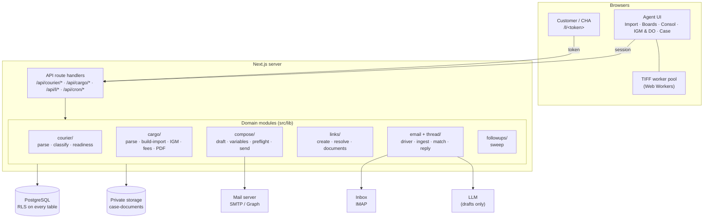
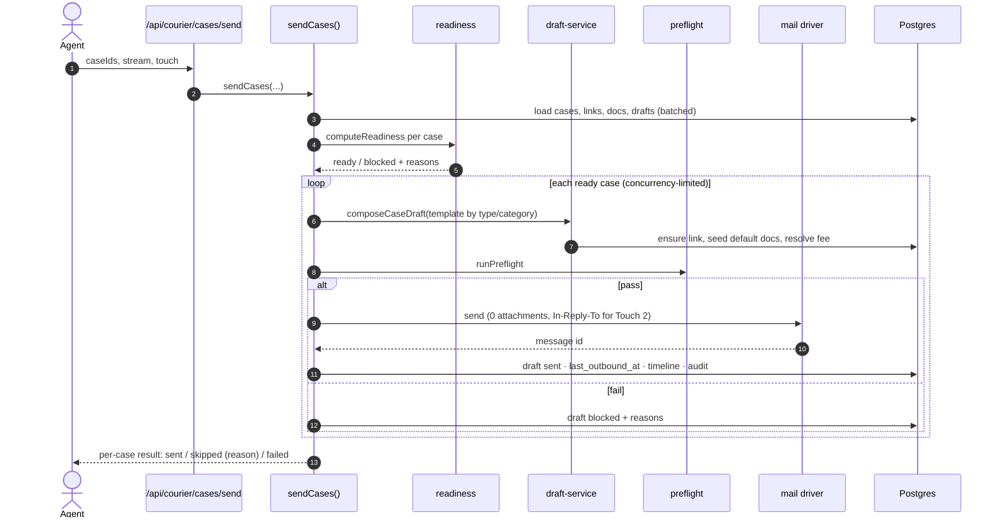
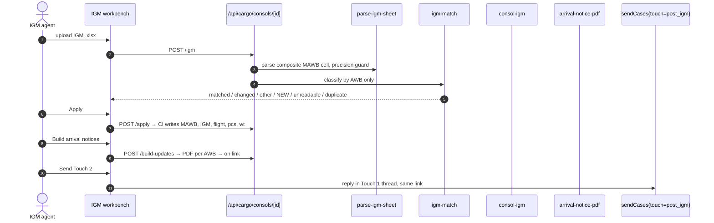
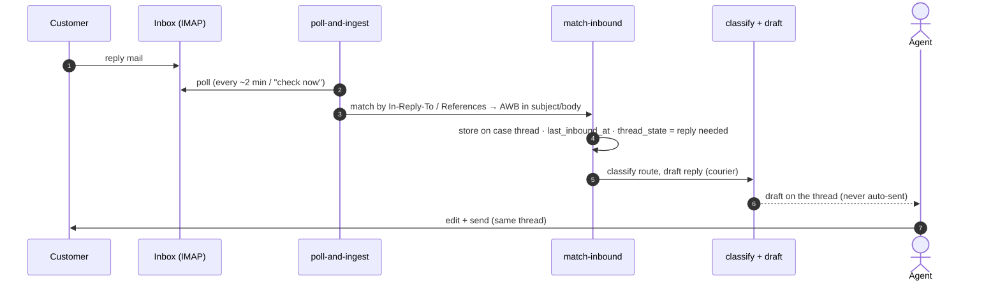
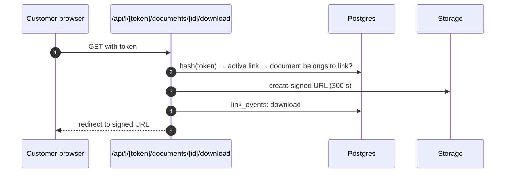

# 07 — Technical Architecture

How the PoC is built, so an engineering team can rebuild it on FedEx's platform. The **design** (flows, rules, data model) is what to keep; the **technology choices** are PoC choices and can be swapped.

---

## 1. Stack

| Layer | PoC choice | Role | Swap-friendly? |
|---|---|---|---|
| Web app | **Next.js 16** (App Router), **React 19**, TypeScript | Pages (server components) + API (route handlers) in one app | Any web stack |
| UI | Tailwind CSS, shadcn / Base UI, lucide icons, TanStack Query | Screens | Yes |
| Database | **PostgreSQL** (Supabase) with row-level security | All data | Any Postgres |
| Auth | Supabase Auth (email login) | Internal users | → Entra ID / SSO |
| Files | Supabase Storage, private bucket `case-documents` | Invoices, uploads, PDFs | → Blob / S3 |
| Outbound mail | Pluggable driver: `smtp` (nodemailer) · `graph` (Microsoft Graph via MSAL) · `dry_run` | Sending | Yes, one interface |
| Inbound mail | IMAP poll (imapflow + mailparser) | Replies | → Graph subscription |
| Excel | exceljs | Sheet import, sample sheets | Yes |
| PDF | pdf-lib | Arrival notice; TIFF pages → PDF | Yes |
| TIFF | utif2 in a browser **Web Worker** pool | Invoice conversion on the agent's machine | Server-side also possible |
| AI | Google Gemini | Reply classification + drafts; never sends | Any LLM, one module |
| Scheduling | Cron routes protected by `CRON_SECRET` | Reminder sweep, inbox poll | Any scheduler |
| Validation | zod on every API input | | |
| Tests | vitest | 67 unit tests | |

---

## 2. Component view

---

## 3. Main flows as sequence diagrams

### 3.1 Bulk send (cargo "Send all ready" / courier bulk send)

### 3.2 IGM sheet → Touch 2

### 3.3 Customer reply

### 3.4 Customer downloads a document

---

## 4. Design rules the code enforces

| Rule | Where | Why |
|---|---|---|
| **Zero attachments on every mail** | `send-draft.ts`, `preflight.ts`, `send-reply.ts` | One source of truth (the link); revocable; logged |
| **Fail-closed pre-send check** | `preflight.ts` | A wrong mail is worse than a late one |
| **One active link per case** | `create-link.ts` | Continuity across touches, stages and desks |
| **Token stored as hash; signed URLs; no storage paths to the browser** | `link-token.ts`, `resolve-link.ts` | A database leak does not expose links or files |
| **Fees only from approved `fee_rules`** | `cargo/fees.ts`, `variables.ts` | No typed or stale amount reaches a customer |
| **Operator chooses the stream (uBond / Consol)** | import route | Same columns; can't be inferred safely |
| **AWB is the only match key** | `igm-match.ts`, `match-inbound.ts` | Names vary |
| **Damaged AWBs rejected** | `parse-igm-sheet.ts`, `parse-sheet.ts` | Excel already lost the digits |
| **Unknown = blocked** | `classify.ts`, `build-import.ts` | No default template, no guessed broker |
| **AI never sends** | `generate-draft-reply.ts` | Human accountability |
| **One pipeline for both desks** | `compose/*` with `division` param | Built once, behaves the same |
| **Status-guarded sends** (`sending` state) | migration 0048, `send-draft.ts` | No double-send on retry |

---

## 5. Configuration

| Variable | Purpose |
|---|---|
| `NEXT_PUBLIC_SUPABASE_URL`, anon / service keys | Database and storage |
| `MAIL_DRIVER` | `smtp` · `graph` · `dry_run` |
| SMTP_* / Graph tenant, client, mailbox | Sending identity |
| IMAP_* | Reply mailbox |
| `CRON_SECRET` | Protects scheduled routes |
| `GEMINI_API_KEY` | AI drafts (optional) |
| `NEXT_PUBLIC_APP_URL` | Base URL in customer links |

`dry_run` composes, checks and records everything but sends nothing: safe for demos and shadow runs.

---

## 6. Security built into the PoC

| Area | What is in place |
|---|---|
| Internal access | Login; roles `admin` / `lead` / `operator` / `reviewer` / `viewer`; per-desk access |
| Data | Row-level security on every table; service key only in server code (`server-only` guard) |
| Inputs | zod validation on every route |
| Customer links | Hashed tokens; one case per link; 5-min signed downloads; full event log; revocable; expiry supported |
| Mail | Zero attachments; validated recipients; team identity; dry-run mode |
| Audit | `audit_logs`, `case_timeline_events`, `message_drafts` (exact content sent), `link_events` |

---

## 7. Recommendations for the production build

| Area | Recommendation |
|---|---|
| Identity | Company SSO; map roles from groups |
| Mail | Send from the desk shared mailboxes through the company mail platform; receive by push, not polling |
| Jobs | Move bulk send, PDF generation, reminder sweep and inbox ingest to a queue with retries |
| Files | Virus scan on customer uploads; server-side TIFF conversion as a fallback |
| Data | Host in an approved region; retention policy per document type |
| Tests | Keep the 67 unit tests' cases as acceptance cases; add end-to-end tests: import → send → IGM → Touch 2 → DO |
| Observability | Per-send logs with message id; dashboards for failed sends, stale threads, unmatched replies |
