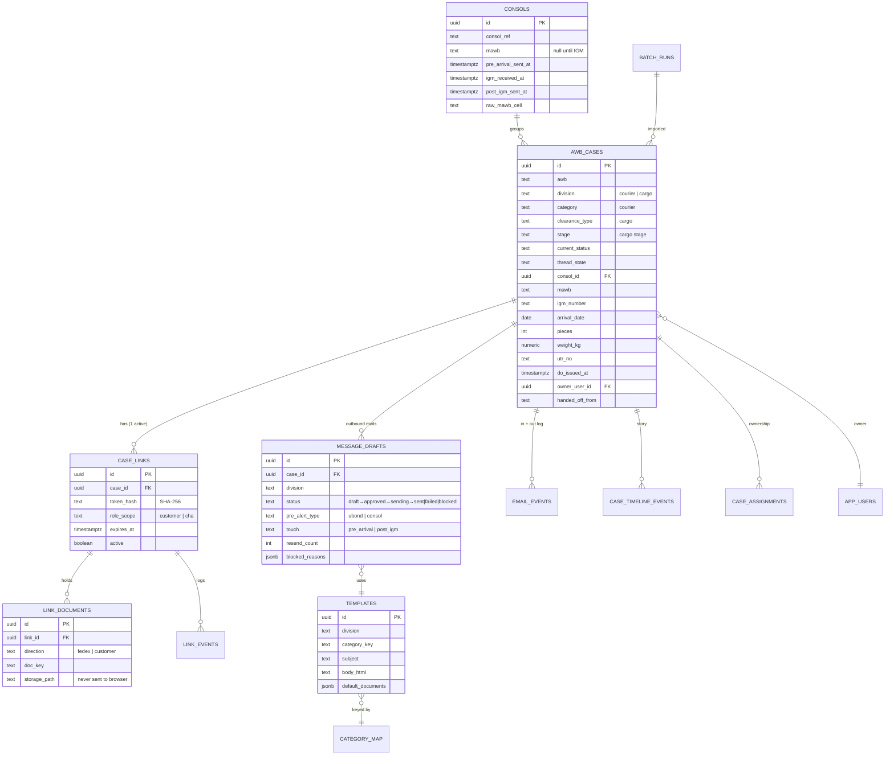
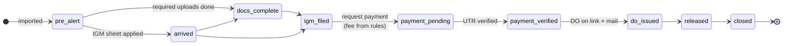
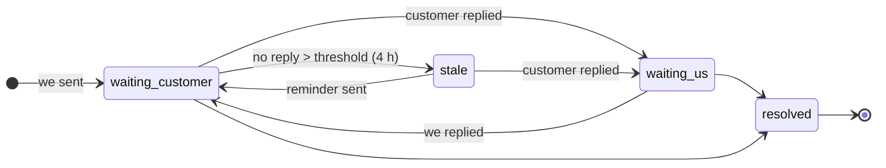
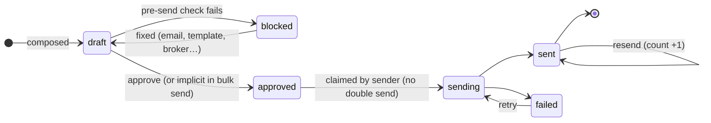
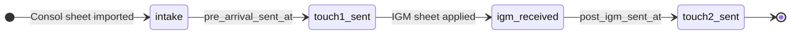
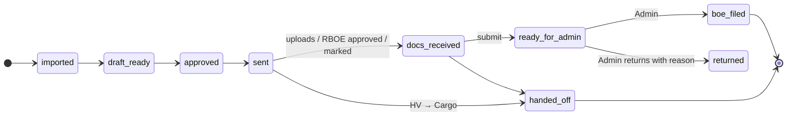

# 08 — Data Model and State Machines

## 1. Entity diagram (core)

---

## 2. Tables by purpose

| Group | Tables | Purpose |
|---|---|---|
| **Case** | `awb_cases`, `consols`, `batch_runs`, `case_assignments`, `case_updates` | One row per AWB per desk; consol grouping; import batches; ownership |
| **Link** | `case_links`, `link_documents`, `link_events` | Secure link, its documents, its activity |
| **Messages** | `message_drafts`, `email_events`, `emails`, `ai_drafts` | Every outbound mail; inbound / outbound log; AI drafts |
| **Configuration** | `templates`, `category_map`, `fee_rules`, `penalty_rules`, `mailbox_configs`, `app_config` | Admin-editable behaviour |
| **People** | `app_users` | Role, desk, active |
| **Audit** | `audit_logs`, `case_timeline_events` | Who did what, per case story |
| **Legacy / earlier experiments** | `reminder_jobs`, `followup_schedules`, `call_tasks`, `clearance_fill*`, `training_examples`… | From earlier iterations; not needed for the flows in this pack |

### Key columns on `awb_cases`

| Group | Columns |
|---|---|
| Identity | `awb`, `division`, `consignee_name`, recipient email |
| Decision | `category` (courier), `clearance_type` (cargo: `nfbrk` / `febrk-jeena` / `febrk-sunimpex`) |
| Manifest | `mawb`, `igm_number`, flight, `arrival_date`, `pieces`, `weight_kg`, `contents`, `manifest_applied_at` |
| Lifecycle | `stage` (cargo), `current_status` (courier + shared), `admin_status` (courier) |
| Payment | DO payment status, `utr_no`, `do_issued_at` |
| Thread | `last_outbound_at`, `last_inbound_at`, `unread_count`, `thread_state` |
| Ownership | `owner_user_id`, `ownership_status`, `claimed_via` |
| Checks | `courier_check_cleared_at`, `courier_check_cleared_by` |
| Hand-off | `handed_off_from`, `handed_off_reason`, `handed_off_at` |

---

## 3. State machines

### 3.1 Cargo case stage

Gate rule: **IGM before payment, payment before DO.** Enforced in `api/cargo/cases/[id]/stage`.

### 3.2 Thread state (both desks)

### 3.3 Outbound mail (message draft)

### 3.4 Consol

### 3.5 Courier case

---

## 4. Configuration data

### `fee_rules` (cargo DO, Delhi)

| Clearance | Day offset from arrival | DO | Admin fee | GST 18% | **Total** | Approved |
|---|---|---|---|---|---|---|
| all | 0 (arrival day) | 2,600 | 0 | 468 | **3,068** | ✓ |
| all | ≥ 1 | 2,600 | 1,000 | 648 | **4,248** | ✓ |

Only rows marked approved are shown to customers. No match → "no approved rule", never a guess.

### `category_map`

| Desk | Keys |
|---|---|
| Courier | `courier_rboe`, `courier_ci_missing`, `courier_invoice_objection`, `courier_content`, `courier_duty`, `courier_pims`, `courier_cbe14`, `courier_port_return`, `courier_value_clarification`, `courier_rr`, `courier_moc`, `courier_reminder` |
| Cargo | `nfbrk`, `febrk-jeena`, `febrk-sunimpex`, `cargo_arrival_notice`, `cargo_reminder` |

---

> **Other gateways:** the PoC data is Delhi-only. Doc 13 adds `gateways`, `gateway_schedules`, `gateway_chas`, `gateway_holidays`, `user_gateways` and a `gateway_code` on cases, consols, batches, fee rules, penalty rules and templates.

## 5. Migrations added in this PoC

| # | Adds |
|---|---|
| 0047 | One link model for both desks |
| 0048 | `sending` status on drafts |
| 0049 | Cargo workspace: consols, stage, thread fields |
| 0050 | Inbound matching |
| 0051 | Cargo fees and timeline |
| 0052 | Board run column |
| 0053 | Arrival notice + reminder categories |
| 0054 | Streams, touches, resend tracking, consol timestamps, nullable consol MAWB |
| 0055 | Consol manifest fields; pieces / weight / contents on cases |
| 0056 | Big-shipment check fields |
