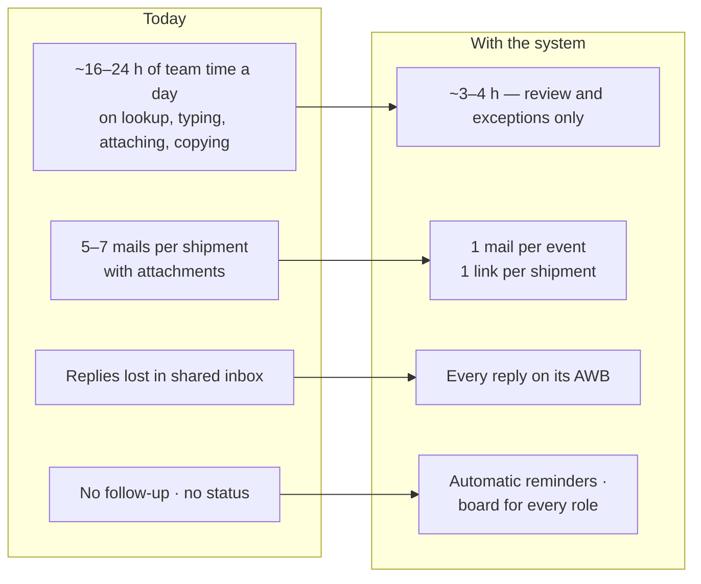

# 11 — Impact

What changes for the team, the customer and FedEx. Each number is marked **Fact** (team figures or FedEx templates) or **Estimate** (an assumption, with the working shown), to be confirmed in a shadow run.

---

## 1. At a glance

| Area | Today | With the system | Basis |
|---|---|---|---|
| Cargo morning batch (200) | 20–30 min VBA run from a personal mailbox | One click; agent free | Fact |
| Cargo broker / email lookup | VLookup + Outlook per AWB | Read from the sheet | Fact |
| Courier mails | 250–300 typed per day | Draft ready per AWB; bulk send | Fact |
| Invoices | `.tif` attached per mail | Dropped once → PDF on link | Fact |
| MAWB / IGM at 14:00 | Copied into each mail | One IGM sheet upload | Fact |
| Replies | Shared inbox | On the AWB, owner alerted | Fact |
| Follow-up | Memory | Automatic | Fact |
| Manager view | None | Boards, timeline, audit | Fact |

---

## 2. Team time (estimate)

| Task | Today / day | With system | Working |
|---|---|---|---|
| Cargo VBA runs (Consol + 2–3 uBond) | 1.5–2 h | ~10 min | 3–4 runs × 20–30 min |
| Cargo VLookup / email search | 1.5–2 h | ~0 | ~250 AWBs × 20–30 s |
| Cargo invoice download + attach | 1–1.5 h | ~10 min | ~250 × 15–20 s |
| Cargo 14:00 MAWB / IGM copy | 1–1.5 h | ~10 min | ~200 × 20–25 s |
| Courier mail writing + attaching | 10–15 h (team) | 2–3 h review | ~275 × 2–3 min → ~30 s review |
| Searching inbox for replies | 1–2 h | ~0 | Replies on the AWB |
| **Total** | **~16–24 h** | **~3–4 h** | **~2 people's time freed** for calls and exceptions |

---

## 3. Money the consignee does not lose

| Event | Cost to consignee (templates) | How the system helps |
|---|---|---|
| Late BOE | ₹5,000/day × 3, then ₹10,000/day | Earlier pre-alert with invoice; Consol Touch 1 before IGM; arrival notice ≤ 30 min after IGM |
| DO not collected on arrival day | +₹1,180 (₹3,068 → ₹4,248) | Today's fee on the link; reminders |
| FEBRK checklist after 18:00 | BOE slips a day | Documents on the link in the morning |
| New TP / part AWBs found late | Shortest window → late BOE | Highlighted the moment the IGM sheet is uploaded |

**Example (estimate):** if 5% of ~220 cargo AWBs a day (11) lose one penalty day or miss arrival-day DO, that is ₹13,000–55,000 a day in customer charges, and a matching number of complaints.

---

## 4. Risk and quality

| Risk today | With the system |
|---|---|
| Wrong recipient (email column holds phone / `0`) | Valid email found across columns; blocked if none |
| Wrong broker (Jeena / Sunimpex templates each name the other) | Broker from the case, never from template text |
| "FEBRK" with no broker | Needs call |
| Courier reason misread | `Master` → category; unknown blocked |
| MAWB on the wrong AWB | AWB-only matching; damaged AWBs rejected |
| Fee typed wrong | Approved fee table only |
| AI says something wrong | AI only drafts |
| History in one person's mailbox | Every mail on the case; team identity |
| Documents forwarded by mail | One logged, revocable link |
| HV hand-off loses history | Same case moves to Cargo |

---

## 5. Customer experience

| Today | With the system |
|---|---|
| 5–7 mails in different formats | One mail per event, one link |
| `.tif` that won't open on phone | PDF on a mobile page |
| Fee table to interpret | Today's fee, and tomorrow's |
| MAWB / IGM in a separate mail | Same thread + arrival notice PDF |
| "What do you still need?" | Checklist with ticks |
| RBOE link pasted in a typed mail | Approve / object on one page |

---

## 6. For management

- **Visibility:** stage, owner and blocker for every AWB, both desks.
- **Accountability:** every send, reply, upload and stage change logged.
- **Control without code:** templates, fees, users managed in the app; VBA and the master Excel retired.
- **One process, two desks:** shared training, reporting and support.

---

## 7. How to measure it (shadow run)

| Measure | Method | Target |
|---|---|---|
| Morning cargo batch time | Stopwatch vs VBA run | < 5 min |
| uBond pre-alerts with invoice | Count | 100% |
| Touch 2 lag after IGM sheet | Timestamps | ≤ 30 min median |
| Silent threads > 4 h without reminder | Board | 0 |
| Courier mails per agent-hour | Count | ≥ 3× today |
| Wrong recipient / broker mails | Audit + complaints | 0 |
| DO collected on arrival day | IGM & DO board | Baseline, then improve |
