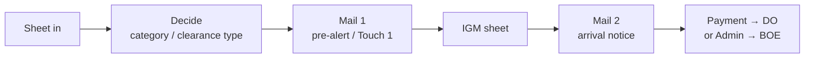
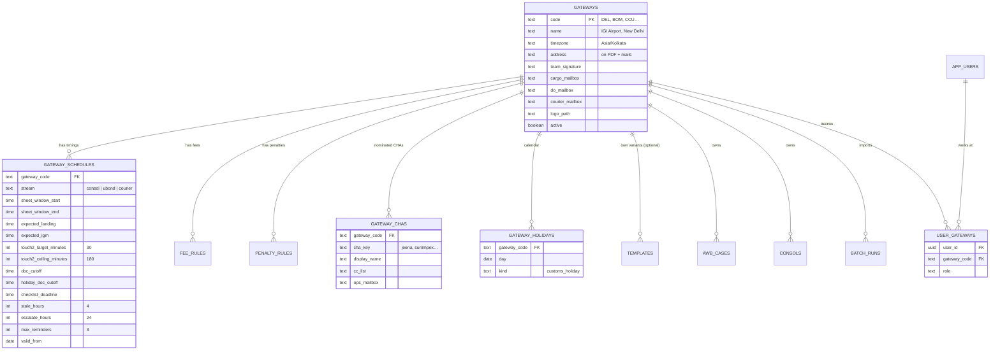
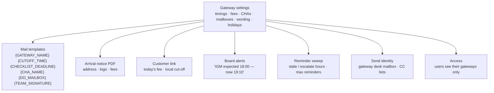
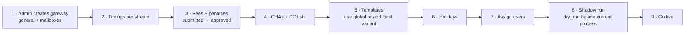

# 13 — Multi-Gateway Design

The PoC runs for **Delhi (IGI)**. The same desks exist at other gateways (Mumbai, Kolkata, Bengaluru, Chennai…) with **the same process but different timings, fees, CHAs, mailboxes and wording**. This document shows how the system becomes **one platform for every gateway**, where an admin sets up a gateway without new code.

Status: ⬜ designed. The PoC is built so this is an extension, not a rewrite (see §7).

---

## 1. Why: same process, different settings

The flow is identical everywhere:



What changes between gateways is **data, not flow**:

| What differs | Delhi (today) | Another gateway (example) |
|---|---|---|
| Flight landing / Consol sheet window | Sheet 06:00–08:00, lands ~08:00 | Sheet 10:00–12:00, lands ~13:00 |
| IGM expected | ~14:00 | ~18:00 or next morning |
| Document cut-off | 16:30 (14:30 customs holiday) | Different local cut-off |
| Checklist approval deadline | 18:00 | Local office close |
| DO fees | ₹3,068 arrival day / ₹4,248 next day | Local tariff |
| Penalty wording | ₹5,000 from day 1 | Kolkata: from day 2 |
| Nominated CHAs | Jeena & Co., Sunimpex | Local CHAs (Kolkata has JFS / Jeena Kolkata) |
| Template variants | NFBRK / FEBRK | Kolkata: Option A (FedEx CHA) / Option B (own CHA) |
| Address, branding, signature | IGI Airport, New Delhi · Delhi Trace Team | Local terminal, local team |
| Mailboxes | Delhi cargo desk, Deldo@ | Local desk and DO mailbox |
| Holidays | Delhi customs holidays | Local calendar |
| Courier pool routing | `BOM` rows → pool | Each gateway's own location code |

**Principle:** nothing gateway-specific lives in code. Everything in the table above is a **gateway setting** the admin controls.

---

## 2. The model: everything belongs to a gateway



### Rules

| # | Rule |
|---|---|
| G1 | Every case, consol, import batch, fee rule, penalty rule and reminder belongs to **one gateway** |
| G2 | A user sees only the gateways they are assigned to; leads and admins can be multi-gateway |
| G3 | The import screen asks for the gateway (pre-selected from the user's default) |
| G4 | Fee and penalty lookups always filter by gateway, then by clearance type and day offset |
| G5 | Template lookup: **gateway-specific variant first, global template as fallback** |
| G6 | All times are stored with the gateway's timezone and shown in local time |
| G7 | Timings are **dated** (`valid_from`), so a schedule change does not rewrite history |
| G8 | A gateway cannot go live until it has: schedule, approved fees, at least one template per type, mailboxes |

---

## 3. What the admin does: gateway setup screen

```
┌ Admin › Gateways › BOM — Mumbai CSIA ─────────────────────────── [ Active ● ] ┐
│                                                                               │
│ GENERAL                                                                       │
│  Name  [ Mumbai CSIA Cargo Terminal       ]   Timezone [ Asia/Kolkata ▾ ]     │
│  Address on PDF / mails [ …                                     ]             │
│  Team signature [ FedEx Clearance Desk · Mumbai Trace Team ]   Logo [Upload]  │
│  Mailboxes: Cargo [ … ]   DO [ … ]   Courier [ … ]                            │
│                                                                               │
│ TIMINGS — Consol                                  valid from [ 01-Dec-2026 ]  │
│  Sheet window   [ 10:00 ] – [ 12:00 ]    Expected landing   [ 13:00 ]         │
│  Expected IGM   [ 18:00 ]                Touch 2 target     [ 30 ] min        │
│  Doc cut-off    [ 17:30 ]  Holiday       [ 15:00 ]  Checklist by [ 18:30 ]    │
│  Reminder after [ 4 ] h   Escalate after [ 24 ] h   Max reminders [ 3 ]       │
│                                                                               │
│ TIMINGS — uBond   [ … ]          TIMINGS — Courier   [ … ]                    │
│                                                                               │
│ FEES (approval required)                                                      │
│  DO — arrival day   ₹ [ … ]   from next day ₹ [ … ]   GST [ 18 ]%  [Submit]   │
│  Penalties  [ day bands ▾ ]  start on day [ 1 ]                               │
│                                                                               │
│ CHAs                                                                          │
│  [ + Add CHA ]   Name · CC list · ops mailbox                                 │
│                                                                               │
│ TEMPLATES   NFBRK ✓ global   FEBRK ✓ local variant   Arrival notice ✓ global  │
│ HOLIDAYS    [ Import calendar ]  12 days set for 2026                         │
│                                                                               │
│ Go-live checks:  ✓ schedule  ✓ fees approved  ✓ templates  ⚠ DO mailbox       │
└───────────────────────────────────────────────────────────────────────────────┘
```

Adding a gateway = fill this screen + get fees approved + assign users. **No developer needed.**

---

## 4. What the gateway settings drive



### New template variables

| Variable | Example (Delhi) |
|---|---|
| `{GATEWAY_NAME}` | IGI Airport, New Delhi |
| `{GATEWAY_CITY}` | Delhi |
| `{DOC_CUTOFF}` | 16:30 (14:30 on customs holidays) |
| `{CHECKLIST_DEADLINE}` | 18:00 |
| `{CHA_NAME}`, `{CHA_CC}` | Jeena & Co. |
| `{DO_MAILBOX}` | DO desk mailbox |
| `{TEAM_SIGNATURE}` | FedEx Clearance Desk · Delhi Trace Team |
| `{DO_FEE}`, `{DO_FEE_NEXT_DAY}` | From the gateway's approved fee rules |

Today's hard-coded "Delhi" wording becomes these variables. One NFBRK template can then serve every gateway; a gateway only needs its own variant where the **process** is different (e.g. Kolkata's Option A / Option B).

---

## 5. Timing-aware board: the clock per gateway

With timings stored, the board knows what *should* have happened by now at each gateway:

| Check | Uses | Board shows |
|---|---|---|
| Consol sheet not imported by window end | `sheet_window_end` | "Consol sheet not imported, window closed 12:00" |
| Touch 1 not sent before expected landing | `expected_landing` | "Touch 1 pending, flight lands 13:00" |
| IGM sheet late | `expected_igm` | "IGM expected 18:00, now 19:10" |
| Touch 2 late | `touch2_target_minutes` after IGM applied | "Touch 2 due 18:30, 12 AWBs not sent" |
| Documents missing near cut-off | `doc_cutoff` (holiday-aware) | "Cut-off in 45 min, 9 AWBs missing documents" |
| Checklist not approved | `checklist_deadline` | "FEBRK approval due 18:30, 3 pending" |
| Thread silent | `stale_hours`, `escalate_hours` | Reminder sent / escalated to lead |

### Manager view across gateways

```
┌ All gateways — today ─────────────────────────────────────────────────────────┐
│ Gateway   AWBs  Touch 1  IGM       Touch 2   Docs missing  DO pending  Alerts  │
│ DEL       224   ✓ 07:42  ✓ 14:05   ✓ 14:31   18            41          1       │
│ BOM       187   ✓ 11:20  ⏳ 18:00   —         27            —           0       │
│ CCU        96   ✓ 09:10  ⚠ late    —         12            —           1       │
└───────────────────────────────────────────────────────────────────────────────┘
```

---

## 6. Rolling out a new gateway



Each gateway can go live on its own; Delhi keeps running unchanged.

---

## 7. What already supports this in the PoC

| Already in place | Why it helps |
|---|---|
| Consol timings are **not hard-coded**: sends happen when the agent acts | Only alerts and wording need the gateway's times |
| Fees come from a **`fee_rules` table** with day offsets and validity dates | Add a gateway column; no logic change |
| Templates are **database rows** with variables | Add gateway variables + a gateway-variant lookup |
| Reminder hours are a **parameter** to the sweep | Read it from the gateway schedule |
| Courier sheet already has a `Location` column (`DEL` / `BOM`) | Gateway on import is natural |
| One pipeline for both desks | Gateway support is added once, works for courier and cargo |

### Delhi-specific values to move into gateway settings

| Today (hard-coded) | Location in PoC | Becomes |
|---|---|---|
| Terminal address and "Delhi" on arrival notice | `src/lib/cargo/arrival-notice-pdf.ts` | `gateways.address`, `{GATEWAY_CITY}` |
| "Delhi · Trace Team" signature, "arrive in Delhi" | `src/lib/templates/presets.ts` | `{TEAM_SIGNATURE}`, `{GATEWAY_CITY}` |
| 4-hour stale threshold | `src/lib/cargo/next-action.ts` | `gateway_schedules.stale_hours` |
| Fee rows without gateway | `fee_rules` | `fee_rules.gateway_code` |
| Jeena / Sunimpex CC lists in template text | Templates | `gateway_chas` |
| `BOM` → pool rule | Courier import | Rows for a gateway the importer doesn't serve → that gateway's pool |
| "Upload IGM sheet at ~14:00" hint | Cargo import screen | `gateway_schedules.expected_igm` |

---

## 8. Build checklist for the production team

| # | Item |
|---|---|
| 1 | `gateways`, `gateway_schedules`, `gateway_chas`, `gateway_holidays`, `user_gateways` tables |
| 2 | `gateway_code` on `awb_cases`, `consols`, `batch_runs`, `fee_rules`, `penalty_rules`, `templates` (nullable = global) |
| 3 | Row-level access by the user's gateways |
| 4 | Gateway picker on import; gateway filter on every board |
| 5 | Template variables from §4; gateway-variant-then-global lookup |
| 6 | Arrival notice PDF reads address, logo and fees from the gateway |
| 7 | Reminder sweep and board alerts read the gateway schedule (timezone + holiday aware) |
| 8 | Admin gateway screen with go-live checks |
| 9 | All-gateways manager view |
| 10 | Migrate Delhi as the first gateway with today's values; behaviour unchanged |
